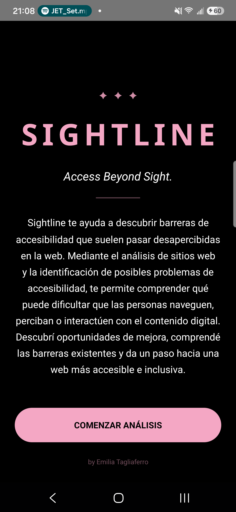
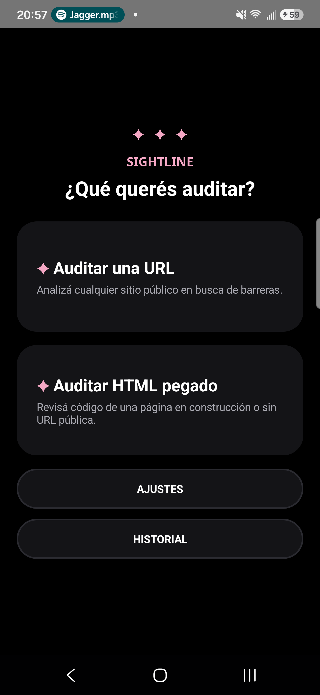
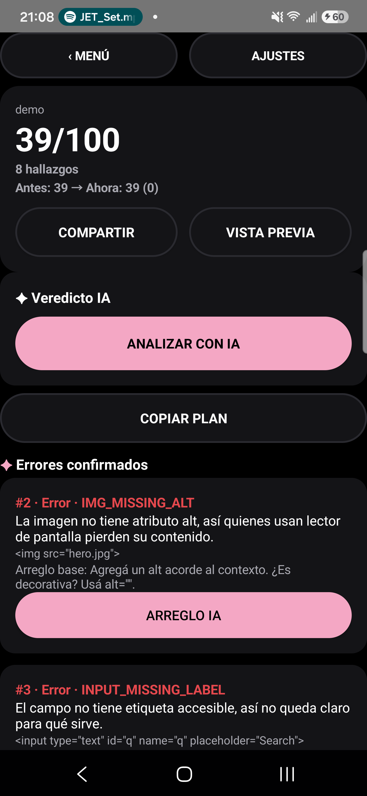
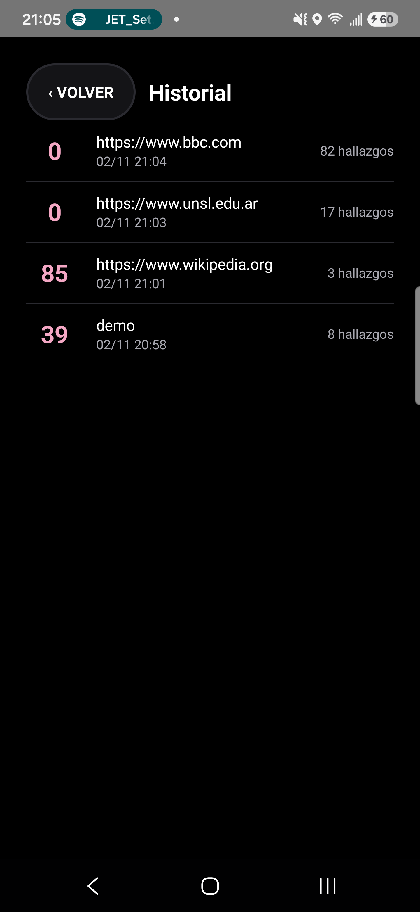

# Sightline — web accessibility audits with Meta AI (Indie track)

Solo entry by **Emilia Tagliaferro** for the Meta Global AI Developer Hackathon.
Everything in this repo was built during the event (Oct 27 – Nov 4).

License: **GNU GPL v3** (see `LICENSE`). All source files carry
`SPDX-License-Identifier: GPL-3.0-or-later`.

Sightline is an Android app that finds accessibility barriers on websites:
images without descriptions, low color contrast, unlabeled form fields and
more. It scores every page 0–100, shows a marked-up preview, and asks
**Muse Spark** (Meta Model API) for a plain-words verdict plus a corrected
code fix, issue by issue.

| Welcome | Menu | Results | History |
|---|---|---|---|
|  |  |  |  |

## Features

* Deterministic on-device WCAG audit (no AI needed to scan): missing alt
  text, missing labels, unnamed buttons/links, heading order, real contrast
  ratios, missing lang/title/viewport, and a 0–100 score.
* **Muse Spark verdict**: 2-sentence assessment + top 3 things to fix first.
* **Per-issue AI fixes** with corrected HTML and one-tap copy; requested
  fixes are cached so credit is never spent twice.
* Marked-up page preview: pink numbered badges match the finding cards.
* Shareable report, copyable fix plan, before/after delta per site.
* Audit history: recent scores with date and findings count.
* Spanish/English UI, light/dark/system theme, help + FAQ, about screen.
* Per-user Meta API key, validated before use and stored encrypted on the
  device; never in the repo, never logged, never shown in full.

## Requirements

* Android 8.0+ (minSdk 26) phone or emulator, with internet for AI features.
* Your own Meta Model API key with credits (each hackathon participant
  claims their own). The offline demo works without a key.

## Install (no coding)

Install `sightline-demo.apk` on your phone (allow "unknown sources" once)
and open Sightline:

1. Welcome shows the brand and **Start**, which asks for your Meta API key
   on first run: what it is, show/hide while typing, real validation
   against the API. You can skip and audit offline.
2. Pick **Audit a URL** or **Audit pasted HTML**, or try the demo page.
3. Read the score and the finding cards, ask for the AI verdict and fixes,
   open the marked preview, share or copy the fix plan.
4. The key stays encrypted on your device; change or forget it in Settings.

## Build from source

Open this folder in Android Studio (Hedgehog+, JDK 17, Android SDK 34) and
run the app, or from the command line with Gradle 8.7:

```sh
gradle assembleDebug testDebugUnitTest
```

The APK lands in `app/build/outputs/apk/debug/`. Copy it to
`sightline-demo.apk` to refresh the installable in the repo root.

## How it works

* `AccessibilityAnalyzer.kt` — deterministic audit (Jsoup, pure Kotlin):
  `IMG_MISSING_ALT`, `INPUT_MISSING_LABEL`, `BUTTON_NO_NAME`,
  `LINK_NO_NAME`, `HEADING_ORDER`, `EMPTY_HEADING`, `LOW_CONTRAST` (real
  WCAG ratio), `MISSING_LANG`, `MISSING_TITLE`, `MISSING_VIEWPORT`, score.
* `MetaAiClient.kt` — AI layer over the Meta Model API
  (`https://api.meta.ai/v1/chat/completions`, model
  `muse-spark-1.3-contributor`): verdict + per-finding fix prompts.
* `MainActivity.kt` — all screens (welcome, key setup, menu, analyzer,
  preview, help, about, history), rotation/process-death persistence.
* `Report.kt`, `History.kt` — shareable report, fix plan, history store.
* `demo.html` — page with 8 planted findings for the 3-minute video.

## Tests

`AccessibilityAnalyzerTest.kt` (JUnit4, `app/src/test`, 36 tests green):
demo findings, clean page, contrast math, scoring, Meta payloads (including
`null` content), language coverage, markers/highlight, fix plan, delta,
help/about/history strings, serialization round-trip.

## Key security

The app talks directly from the device to the Meta Model API: no backend,
no key logs (verified in logcat). Each user brings their own key.
`.apikey` and `local.properties` are git-ignored; verify with
`git status --porcelain` before pushing.

## Demo script (3 min)

1. (0:00) "1 in 6 people live with disability, yet most sites fail basic
   checks. Sightline finds those barriers and helps fix them."
2. (0:25) Welcome → key setup (validated) → menu with two tools + history.
3. (0:50) Demo page: score 39/100, 8 finding cards in plain words.
4. (1:30) AI verdict, then an AI fix with corrected code + copy.
5. (2:00) Marked preview with numbered badges; fix plan shared.
6. (2:25) Real URL live audit; history collects every score.
7. (2:50) "Deterministic audit plus Meta reasoning, offline-first,
   bilingual, open source. Built with Muse Spark via the Meta Model API."

## Submission checklist (due Nov 4, 9:00 PM ET)

* [x] Public repo, all work from the event, solo entry.
* [ ] 3-minute demo video showing only hackathon-built features.
* [ ] Video link + repo accessible, APK installable for judges.
* [ ] Listed on the submission page (solo: 1).

## Rubric mapping

Impact (30%): real web accessibility for people with disabilities.
Meta AI tooling (25%): Muse Spark verdict + contextual per-issue fixes.
Technical depth (20%): own tested WCAG engine + API client + persistence.
Demo (25%): guaranteed offline demo plus live AI and real URLs.
